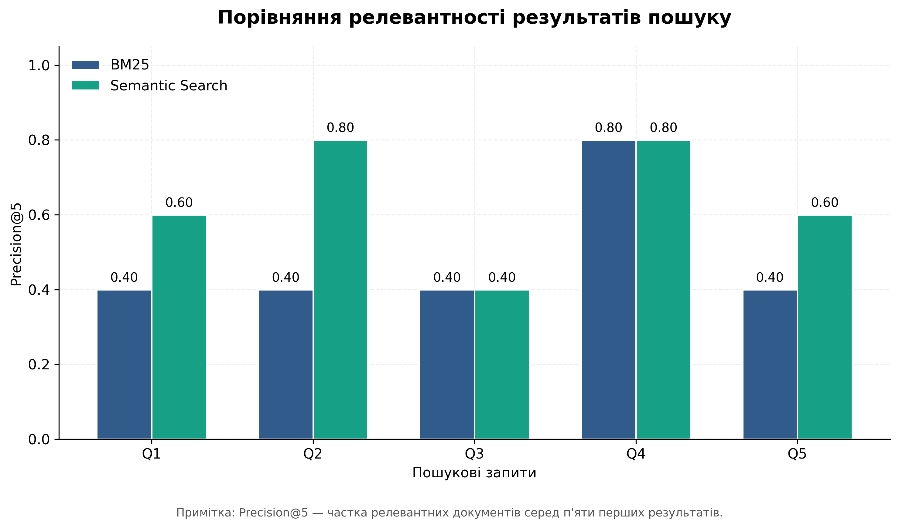
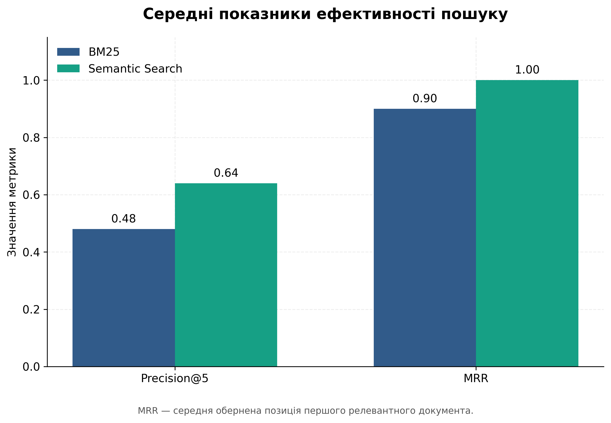
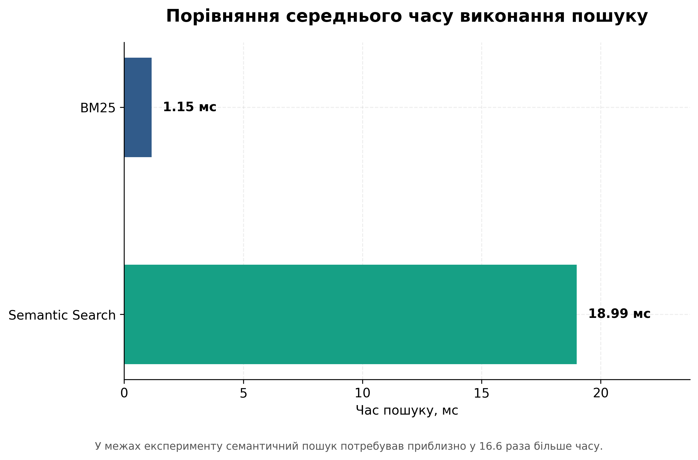

# Semantic Search for Supporting Business Management Decisions

## Research Overview

This project investigates the application of semantic search for supporting managerial decision-making in business.

The study compares traditional keyword-based retrieval (BM25) with semantic search based on sentence embeddings.

## Research Question

Can semantic search improve the relevance and efficiency of information retrieval for managerial decision-making compared with traditional keyword-based search?

## Methodology

The pilot experiment uses:

- 20 test documents;
- 5 managerial search queries;
- BM25 as a keyword-based retrieval baseline;
- Sentence Transformers (all-MiniLM-L6-v2) for semantic search.

Evaluation metrics:

- Precision@5;
- Mean Reciprocal Rank (MRR);
- Search execution time.

## Experimental Results

| Metric | BM25 | Semantic Search |
|---|---:|---:|
| Precision@5 | 0.48 | 0.64 |
| MRR | 0.90 | 1.00 |
| Search time (ms) | 1.15 | 18.99 |

The pilot experiment indicates higher retrieval relevance for semantic search, while BM25 demonstrates lower search execution time.

## Visual Results

### Precision@5 by Query

### Mean Retrieval Metrics

### Search Execution Time

## Technologies

- Python
- Pandas
- NumPy
- Matplotlib
- Sentence Transformers
- Google Colab

## Project Structure

- `data/` — test documents, queries and relevance judgments
- `src/` — experimental implementation
- `results/` — experimental results
- `figures/` — generated visualizations

## Limitations

This is a small exploratory pilot experiment based on a curated test collection of 20 documents and five queries. Relevance judgments were manually prepared.

The results should not be interpreted as representative of all business information retrieval systems.
